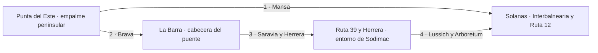

# UrbanFlow · Etapa 1B · Inventario vial regional v001

Primera entrega sobre el snapshot OSM compartido del **10/11/2026 a las 21:21:39 UTC**, SHA-256 `868b473a814999649af1d03ba164be232320c9dd82a229d5514315c0afc3a272`. El inventario contiene los cuatro recorridos candidatos y las vías motorizadas del interior que delimita su geometría. La evidencia procede de OSM y las fuentes oficiales citadas contextualizan los corredores. No se ejecutó `netconvert` ni SUMO. [Inventario GeoJSON](../results/etapa1b-v001/inventory.geojson) · [Inventario y trazas JSON](../results/etapa1b-v001/inventory.json)

## 1. Mapa lógico y corredores



Las flechas representan el orden de trabajo y los recorridos candidatos. Cada trayectoria del GeoJSON sigue segmentos entre nodos OSM consecutivos. El punto inicial elegido es el nodo `840834919`, en el empalme de Rambla Williman y El Remanso, cerca de la península. La Barra se ancla en `321554949`, en la cabecera este del puente Leonel Viera. Para Sodimac se usa el nodo vial `1762766287` en el entorno del cruce Ruta 39–Herrera. La selección del nodo no identifica el acceso comercial. Solanas se ancla en `1761794826`, sobre la Interbalnearia junto al distribuidor de Ruta 12.

| Orden | Traza candidata y conexiones | Longitud | Geometría presente | Longitud sobre vías preferidas |
|---|---|---:|---:|---:|
| 1. Punta → Solanas | Rambla Claudio Williman hasta su enlace con la Interbalnearia en el entorno de Punta Ballena (`1761803594`), y por la Interbalnearia al distribuidor de Ruta 12. | 15,048 km | 100 % | 99,69 % |
| 2. Punta → La Barra | Williman → Emilio Sader → Bulevar Artigas → Rambla Lorenzo Batlle Pacheco → puente Leonel Viera. El enlace peninsular seleccionado evita preferir vías de servicio para ahorrar distancia. | 10,080 km | 100 % | 89,40 % |
| 3. La Barra → Ruta 39–Herrera | Retorno por la otra calzada del puente vía Haedo y Juana de América. Empalme con Aparicio Saravia mediante el entorno de José Cuneo y conexiones locales. Después, Saravia y avenida Luis Alberto de Herrera hasta Ruta 39. | 11,862 km | 100 % | 91,49 % |
| 4. Ruta 39–Herrera → Solanas | Herrera, empalmes de Wilson Ferreira Aldunate y avenida Antonio Lussich. Pasa por el entorno del Arboretum (`2367503408`) y termina por la Interbalnearia. | 9,831 km | 100 % | 94,54 % |
| Alternativa del tramo 4 | Variante con tramos etiquetados literalmente `Camino Lussich`, vía `1886195541` y `1307973260`. Se reintegra a la avenida hacia el Arboretum. Se conserva como alternativa al eje principal. | 10,084 km | 100 % | 94,67 % |

La cobertura geométrica se mide sobre las trayectorias obtenidas entre las anclas: **10 de 10 pares de anclas principales conectados** y geometría disponible en todos sus segmentos. El porcentaje de vías preferidas mide longitud sobre los nombres configurados. Un porcentaje menor señala enlaces, rotondas o calles de transición que conviene revisar. Estos resultados no miden la proporción de la red vial física que está mapeada. El recorrido es un candidato según el grafo dirigido y los accesos explícitos del snapshot. Los sentidos inferidos y las restricciones condicionales quedan sujetos a validación. El JSON enumera todos los IDs OSM, los nodos consecutivos y la secuencia por corredor.

Para el tramo 3, la alternativa de seguir por la margen este hacia Cerro Eguzquiza queda sin itinerario confirmado hacia el cruce de Ruta 39 que pidió el usuario. El Digesto menciona la Rambla del Humedal como conexión este–oeste. La traza de esta entrega usa la conexión existente por los puentes, Saravia y Herrera. Queda por validar qué acceso local de Saravia y qué variante Lussich conviene adoptar para el perímetro operativo. [Puentes de La Barra](https://www.maldonado.gub.uy/pagina/barra-manantiales) · [Rambla del Humedal en el Digesto](https://digesto.maldonado.gub.uy/index.php/armado-parte/26) · [Arboretum Lussich](https://www.maldonado.gub.uy/pagina/museo-arboretum-lussich)

## 2. Perímetro e inventario interior

La unión de los cuatro recorridos principales tiene una cara mayor que define el interior de trabajo y una cara menor en el entorno de Saravia–Herrera, donde divergen y se reencuentran las calzadas. Para delimitar el área se usa la unión geométrica de ambas caras, sin cerrar brechas con líneas rectas ni cambiar sentidos de circulación. Se registran **44 segmentos colgantes**, cero anillos inválidos y cero líneas de corte en el resultado del poligonizado. Los colgantes permanecen en la capa de evidencia y no se rellenan. Mansa y Lussich comparten **31 segmentos** del acceso hacia Solanas. El extremo de Solanas queda conectado al perímetro por ese acceso y fuera de su cara principal. Las dos calzadas de Leonel Viera aparecen por separado, con sus propios nodos. La Barra queda representada por la cabecera y los enlaces de retorno. Esta cara describe el interior del itinerario solicitado. Los sectores urbanos que queden fuera requerirán ampliaciones explícitas en incrementos posteriores.

- **Snapshot:** 5.299 vías motorizadas inventariadas, desagregadas en 34.843 segmentos OSM. No se encontraron pares de nodos consecutivos sin geometría. Se incluyen calles residenciales y de servicio. Los senderos, veredas independientes y otros tipos de vía fuera del conjunto motorizado quedan fuera de este inventario. Se conserva el etiquetado bruto de las vías incluidas.
- **Interior:** 19.213 segmentos estrictamente interiores de 3.155 vías OSM, más 1.225 segmentos que están sobre el perímetro o lo cruzan. Se conservan segmentos completos y sus nodos originales para evitar crear empalmes artificiales en el borde. El subgrafo débil de esos segmentos tiene un componente de 17.487 nodos. Eso acredita conectividad por nodos compartidos. La conectividad dirigida entre todos los accesos y los giros permitidos requiere comprobaciones adicionales.
- **Cruces y señales:** 4.988 nodos dentro o sobre el perímetro con al menos tres vecinos viales, 151 nodos `traffic_signals` y 89 nodos `crossing` dentro o sobre el perímetro. Los conteos pueden solaparse. No equivalen a intersecciones físicas deduplicadas, controladores o cebras verificadas. `crossing` indica cruce peatonal mapeado, con el detalle de pintura disponible en sus etiquetas.
- **Rotondas y restricciones:** 44 vías con `junction=roundabout` en el snapshot, de las cuales 24 cierran en una única vía OSM. Dos vías de rotonda, `1428227104` y `1428227106`, quedan parcialmente intersectadas por el perímetro y requieren comprobación del grupo completo antes de compilar. Los anillos de Joaquín de Viana (`121504388`) y Camacho (`100473863`) quedaron íntegros en el interior. Las 51 relaciones de restricción conservadas tienen todos sus miembros en el snapshot. El cotejo preliminar no marcó conflictos en los candidatos. Su alcance es revisar giros con nodo `via` y señalar coincidencias potenciales de vías `via`. No certifica restricciones horarias, excepciones por clase o la integridad del conjunto original de relaciones de OSM.
- **Faltantes en el interior:** 15.838 segmentos sin etiqueta `lanes` total, 17.723 sin `maxspeed`, 12.235 sin `oneway` explícito, 4.910 sin nombre y 3.815 sin superficie. Se conservan etiquetas direccionales como `lanes:forward` cuando existen, aunque falte el total. La ausencia de `oneway` se registra y el sentido por defecto se marca como inferido. No se completaron prioridades, semáforos ni fases.

[Datos de geometría y atributos](../results/etapa1b-v001/inventory.geojson) · [Relaciones, estructuras en el borde y métricas](../results/etapa1b-v001/inventory.json)

## 3. Sectores y orden de incorporación

El inventario asigna una sola etiqueta de sector a cada segmento incluido, según proximidad a los nodos semilla configurados. Las fronteras de sector son una ayuda de trabajo y no recortan el grafo. Los sectores comparten las referencias OSM de cada cruce y límite. El esquema usa `osmWay` más índice de segmento dentro del snapshot y conserva los dos nodos extremos. Una corrección futura debe referenciar entidad, sentido, vigencia y precondiciones en ese snapshot. Los cambios de snapshot requieren reconciliar referencias.

| Orden | Sector inicial | Segmentos interiores o de borde |
|---|---|---:|
| 1 | Punta–Mansa | 4.392 |
| 2 | Mansa oeste–Punta Ballena–Solanas | 2.026 |
| 3 | Brava–La Barra | 1.020 |
| 4 | Saravia y enlace con Herrera | 6.044 |
| 5 | Ruta 39–Herrera | 3.145 |
| 6 | Lussich en Maldonado | 3.228 |
| 7 | Lussich–Arboretum | 583 |

Se conserva una única fila geométrica por segmento aunque aparezca en varios recorridos. El GeoJSON lista sus corredores asociados. Las futuras correcciones aprobadas se acumulan por versión y se aplican a la misma red fuente al crear nuevas referencias. Los sectores no son redes SUMO que deban concatenarse. Honduras y Camacho conservan sus paquetes certificados y las regresiones de 1A. [Contratos de 1A](IMPLEMENTACION_ETAPA1A_COMPILADOR_VIAL.md)

## 4. Archivos y verificación

- [`regional_inventory.py`](../sumo_scenario/regional_inventory.py) genera el inventario, rutas candidatas, perímetro, sectores y alertas sin compilar una red SUMO. Usa el lector del snapshot existente y Shapely para polígonos y cruces de borde. Se usó Shapely 2.1.0 ya disponible, sin instalaciones.
- [`corridors-v001.json`](../sumo_scenario/regional/corridors-v001.json) declara anclas, vías preferidas, la variante Lussich y sectores. La búsqueda favorece vías preferidas y penaliza vías de servicio. Las coincidencias por nombre orientan la búsqueda. La conexión siempre procede de nodos OSM compartidos y respeta sentidos y exclusiones de acceso aplicados.
- [`test_regional_inventory.py`](../tests/test_regional_inventory.py) cubre sentido explícito e inferido, acceso privado, falta de geometría sin atajo artificial, cadenas abiertas, restricciones y generación real del inventario. **6 pruebas aprobadas.** También pasaron las **11 pruebas del compilador 1A y las 9 de baseline estricta**. Las huellas de los 93 archivos históricos coincidieron.

```powershell
python -B -m unittest discover -s tests -p test_regional_inventory.py -v
$out = 'results/etapa1b-local-' + [guid]::NewGuid().ToString('N')
python -B -m sumo_scenario.regional_inventory sumo_scenario/regional/corridors-v001.json $out
```

**Próximo incremento recomendado.** Fijar los empalmes de los dos puentes, Saravia–Herrera y el acceso común a Solanas sobre el GeoJSON. Usar como primer control de borde las vías `1428227104` y `1428227106`. Comprobar su ciclo completo, accesos y restricciones y registrar qué expansión de perímetro hace falta. Esa prueba se puede repetir por sector antes de compilar la base completa.
