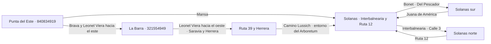

# UrbanFlow · Etapa 1B.1 · Perímetro regional v002

**Perímetro conectado en el inventario OSM.** La revisión v002 incorpora dos caras de Solanas y sus accesos dirigidos, adopta Camino Lussich como corredor principal y conserva el anillo completo que atraviesa el borde en Punta Ballena. El alcance es el territorio delimitado por estos recorridos. Los límites administrativos y las calles de Solanas por fuera de ambos circuitos quedan disponibles en el snapshot para incrementos posteriores. [Inventario JSON v002](../results/etapa1b-v002-consolidado/inventory.json) · [GeoJSON v002](../results/etapa1b-v002-consolidado/inventory.geojson) · [Referencia v001](ETAPA1B_INVENTARIO_REGIONAL.md)

El insumo sigue siendo el snapshot compartido del **10/11/2026, 21:21:39 UTC**, SHA-256 `868b473a814999649af1d03ba164be232320c9dd82a229d5514315c0afc3a272`. Los identificadores de segmento se expresan como vía OSM e índice entre nodos consecutivos, válidos para esta revisión del snapshot. [Procedencia y licencia OSM](https://www.openstreetmap.org/copyright)

## Recorridos elegidos



- **Mansa, 15,048 km.** Se conserva la traza Williman → Interbalnearia → distribuidor de Ruta 12. Comparte 31 segmentos de llegada con Lussich. El ramal compartido sigue siendo parte del acceso vial y enlaza las caras de Solanas con el corredor regional.
- **Brava, 10,080 km.** Se conserva la llegada por rambla Lorenzo Batlle Pacheco y el puente de ida hasta la cabecera este. La vuelta usa el otro puente.
- **Interior, 10,798 km.** La Barra → Haedo y Juana de América → puente hacia el oeste → José Cuneo y enlaces locales → Aparicio Saravia → anillo de Saravia–Herrera → Herrera → Ruta 39. Las anclas v001 `321554874` y `1919675885` obligaban a volver sobre segmentos y a recorrer parte del empalme dos veces. Las anclas v002 `1164319605` y `7316611215` conservan el movimiento Saravia → Herrera con 322 segmentos sin repeticiones, frente a 358 pasos y 347 segmentos únicos de v001. El ramal descartado sigue en el inventario OSM.
- **Lussich, 10,536 km.** Ruta 39–Herrera → conexiones a avenida Antonio Lussich → **2,593 km continuos** etiquetados `Camino Lussich` → avenida Antonio Lussich en el entorno del Arboretum → Interbalnearia. La secuencia de Camino comprende `227841341`, `227841338`, `186521532`, `224769414`, `592439263`, `224769415`, `178247868` y `1136781094`. La transición a la avenida pasa por `2367503408`, coherente con la ubicación publicada del Arboretum en avenida Antonio Lussich. El tramo `224769415` está etiquetado como puente y varias vías de Camino carecen de etiqueta de carriles, superficie o velocidad. [Intendencia de Maldonado, Museo Arboretum Lussich](https://www.maldonado.gub.uy/pagina/museo-arboretum-lussich)
- **Alternativa por avenida Antonio Lussich, 9,831 km.** Sigue íntegramente el itinerario principal v001 y también llega al entorno del Arboretum. Permanece como variante en el JSON y el GeoJSON. El menor kilometraje no compensa que omita Camino Lussich para el trazado solicitado. La variante de 10,084 km de v001 queda en su referencia histórica. La v002 usa anclas adicionales para sostener la continuidad de Camino.

## Cierre de Solanas y empalmes dirigidos

Desde el nodo `1761794826` se incorporan dos circuitos completos sin nodos repetidos, salvo el inicio y fin. Cada circuito delimita su propia cara a partir de segmentos OSM y comparte el nodo con la red principal. No se trazaron líneas para unir orillas ni calzadas paralelas.

- **Sur, 2,723 km y 113 segmentos.** Rampa `185325886` → enlace `245367205` → Bonet → China Zorrilla → Lucero del Alba → Del Pescador → De los Recuerdos → De la Encandilada → Milton Lussich → Del Portezuelo → Juana de América → rampa `164559156` → Interbalnearia oeste `185325837`.
- **Norte, 10,036 km y 217 segmentos.** Interbalnearia oeste `164559879` → conector de retorno `457290992` → calzada este `164556453` → Calle 3 → Bahía Algeciras y avenida Bahía Portezuelo → Cabo Polonio y calles del entorno de Laguna del Sauce → Ruta 12 `185325842`, `115675908` y `164559170` → distribuidor. El retorno se hace por el conector mapeado y la entrada local ocurre en el nodo compartido `1893553112`.
- **Alternativas descartadas.** Terminar en el distribuidor dejaba Solanas fuera de la cara, como en v001. El circuito corto por la doble calzada y Ruta 12 cubre principalmente el distribuidor y la franja entre calzadas. El acceso directo a Calandria por el nodo `1942747943` queda excluido del grafo público del inventario porque las vías `183857049` y `183857097` declaran `access=private`. En el enlace de Lussich, `1761803455` y `1761803446` pertenecen a calzadas distintas. Su cercanía geométrica no da continuidad vial.

| Empalme auditado | Secuencia OSM en el sentido recorrido |
|---|---|
| Leonel Viera hacia La Barra | `184300533 → 29235037 → 184300539`, con nodos `321554873 → 321554949` en el puente. |
| Leonel Viera hacia Punta del Este | `182082909 → 184300558 → 231215103`, con nodos `1164319460 → 1164319591` en el puente. Los dos pasos elevados declaran `bridge=yes`, `layer=1` y `oneway=yes`. |
| Saravia → Herrera | `100719068 → 100719054 → 362483925`, en `1164319605` y `3906651726`. Los accesos declaran sentido único. El sentido de `100719054` se infiere de `junction=roundabout`. El ciclo completo comprende también `230972662`. |
| Lussich → Interbalnearia | `164559871 → 185325840` en `1761803455`. Ambas vías declaran sentido único en la dirección recorrida. |
| Distribuidor → Solanas sur → distribuidor | `185325837 → 185325886` en `1761794826`; `185325886 → 245367205` en `1761794833`; `164559156 → 185325837` en `1761794864`. En `245367205` se infiere doble sentido. |
| Distribuidor → Solanas norte → distribuidor | `185325837 → 164559879` en `1761794826`; `164556453 → 181223974` en `1893553112`; `115675908 → 164559170` en `1761794832`. En Calle 3 se infiere doble sentido. |

El grafo verifica nodos compartidos, sentido y acceso explícito para las trazas. El JSON registra 17 empalmes dirigidos, incluidas las dos transiciones entre circuitos, y revisa las 51 relaciones de restricción del snapshot con todos sus miembros presentes. Siete relaciones mencionan vías usadas, pero ninguna coincide con los giros seleccionados en este cotejo. Tampoco aparecieron etiquetas condicionales de vía en las trazas. Los giros y cambios de carril permitidos, las restricciones omitidas del snapshot, los accesos señalizados y la circulación por todos los pares origen–destino requieren evidencia adicional. La Intendencia confirma la existencia de los dos puentes. Los sentidos descritos proceden de OSM. [Intendencia de Maldonado, La Barra y Manantiales](https://www.maldonado.gub.uy/pagina/barra-manantiales)

## Anillo de Punta Ballena y expansión de borde

`1428227104` y `1428227106` forman parte de un único ciclo dirigido de **34 segmentos**, sin nodos ausentes. El orden es `1428227104 → 1207049875 → 1428227107 → 1428227105 → 1428227106 → 1428227113 → 1428227104`. El sentido procede de la etiqueta `junction=roundabout`. El anillo tiene siete vías motorizadas incidentes en OSM: `1207049874`, `1207629036`, `1207629037`, `1428227112`, `1430696508`, `1430696509` y `476652749`. Las vías `1207629036` y `1207629037` son dos mitades de un enlace de servicio que vuelve al anillo. `1207049874` se conecta en `11184758525`, un nodo intermedio de una vía del anillo.

El polígono deja fuera **25 segmentos del anillo**. La selección de trabajo incorpora esos 25 y **25 segmentos adicionales de sus accesos** mediante `preserveFor: roundabout-expansion`. La envolvente de las trece vías completas en orden oeste, sur, este, norte es `[-55.0220842, -34.90986, -55.0029596, -34.9059899]`. Es la extensión suficiente para incluir estas vías completas del snapshot. Para compilar, comprobar en el recorte resultante los seis miembros, las siete vías incidentes y las relaciones que los referencien, además de dejar espacio para los accesos y las colas. Un recorte que sólo cubra las dos vías señaladas puede volver a cortar el anillo.

## Diferencias respecto a v001

| Métrica comparable | v001 | v002 |
|---|---:|---:|
| Pares de anclas conectados, cuatro corredores principales | 10/10 | 14/14 |
| Pares de anclas de los circuitos de Solanas | — | 7/7 |
| Geometría de los recorridos obtenidos | 100 % | 100 % |
| Segmentos únicos sobre los recorridos del perímetro | 1.089 | 1.430 |
| Segmentos estrictamente interiores | 19.213 | 20.039 |
| Vías OSM con segmentos estrictamente interiores | 3.155 | 3.277 |
| Segmentos sobre el borde o que lo cruzan | 1.225 | 1.670 |
| Selección geométrica sobre los 34.843 segmentos del snapshot | 20.438 (58,66 %) | 21.709 (62,31 %) |
| Selección con conectores y preservación explícita | 20.438 (58,66 %) | 21.793 (62,55 %) |
| Componentes débiles de la selección geométrica | 1 de 17.487 nodos | 2 de 17.657 y 999 nodos |
| Componentes débiles con conectores y preservación | 1 de 17.487 nodos | 1 de 18.737 nodos |
| Caras / colgantes / cortes / anillos inválidos | 2 / 44 / 0 / 0 | 3 / 40 / 0 / 0 |
| Grupos de rotonda con segmentos fuera de la selección geométrica | 1 | 1 |
| Grupos de rotonda cortados en la selección de trabajo | 1 | 0 |
| Nodos con al menos tres vecinos dentro o sobre el perímetro | 4.988 | 5.217 |
| Nodos `traffic_signals` / `crossing` dentro o sobre el perímetro | 151 / 89 | 151 / 89 |

En la traza del perímetro entran 408 segmentos y salen 67. En la selección geométrica entran 1.289 y salen 18, con un neto de 1.271. Solanas norte suma 611 y Solanas sur suma 445. El nuevo trazado aporta 223 en Lussich–Maldonado y 10 en Lussich–Arboretum. Los 18 que salen están en Saravia y sus enlaces próximos, dentro del sector Brava–La Barra v001. Siguen con IDs y geometría en el GeoJSON. Punta–Mansa, Mansa oeste, Saravia y Ruta 39–Herrera conservan sus conteos geométricos.

La selección final conserva además 34 segmentos de trazas que quedan fuera de las caras y 50 de expansión de rotonda. El GeoJSON distingue ambas causas mediante `preserveFor`. Los sectores siguen etiquetados por proximidad para organizar el trabajo, con una sola geometría por segmento. La cobertura anterior mide el snapshot sobre el perímetro adoptado. Quedan, entre otros faltantes, 16.610 segmentos interiores sin `lanes`, 18.533 sin `maxspeed` y 12.983 sin `oneway` explícito.

## Pruebas y criterios de aceptación

- `sumo_scenario/regional/corridors-v002.json` fija los itinerarios, anclas, circuitos, empalmes y sectores. `regional_inventory.py` verifica continuidad dirigida, cierra cada circuito por nodos OSM, registra las caras por separado y conserva estructuras completas de borde. Rechaza circuitos abiertos, repetidos o desconectados del trazado principal.
- **9 pruebas de inventario**, **11 de contrato 1A** y **9 de baseline estricta** aprobadas, sin omisiones. La comparación estricta usó las redes de cierre de 1A y la referencia ampliada independiente de Camacho. Las cuatro corridas conservaron nombres y SHA-256 en sus **93 archivos**, cotejados con `historicos-despues.json`. Los dos archivos del inventario v001 conservaron sus huellas originales. Una segunda generación de v002 en otro directorio reprodujo exactamente los SHA-256 del JSON y del GeoJSON. Los resultados bajo `results/` son evidencia local regenerable.
- La aceptación de este perímetro requiere conservar los dos circuitos dirigidos, los 17 empalmes auditados, un único componente débil en la selección completa, cero anillos geométricos inválidos y cero anillos viales incompletos en la selección de trabajo. Estos criterios se verificaron en v002. Para aceptar un futuro recorte SUMO hay que comprobar que preserve esas estructuras cuando las interseca, incluyendo accesos y restricciones. Continúan pendientes las verificaciones físicas de giros, prioridades y fases en las zonas nuevas.

```powershell
$out = 'results/etapa1b-v002-local-' + [guid]::NewGuid().ToString('N')
python -B -m sumo_scenario.regional_inventory sumo_scenario/regional/corridors-v002.json $out
python -B -m unittest discover -s tests -p test_regional_inventory.py -v
python -B -m unittest discover -s tests -p test_network_compiler.py -v
$env:URBANFLOW_BASELINE_STRICT = '1'
$env:URBANFLOW_BASELINE_HONDURAS = 'results/etapa1a-cierre-b4ac0b57/compilada-honduras/network.net.xml'
$env:URBANFLOW_BASELINE_CAMACHO = 'results/etapa1a-cierre-b4ac0b57/compilada-camacho/network.net.xml'
$env:URBANFLOW_BASELINE_BASE_CAMACHO = 'results/camacho-0c-d0025f9d/congelacion/camacho-ampliada/repeticion-1/network.net.xml'
python -B -m unittest discover -s tests -p test_baseline_v001.py -v
```

## Primer sector a compilar

**Punta del Este → Mansa por Williman, desde el empalme peninsular `840834919` hasta Pirineos `1761803640`**, unos **1.452 m** sobre la traza de ida. El núcleo abarca `99944425`, `482520536` y el tramo correspondiente de `1346593267`. La semilla `1957626365` cae dentro del tramo y permite concentrar el primer examen en un conjunto de accesos y señales ya inventariados.

En la siguiente entrega, preparar un único recorte desde el snapshot compartido. Extenderlo por ambas calzadas, incluyendo el empalme peninsular, los cruces de Emilio Sader, Miami, El Pinar y Pirineos, los ramales y las relaciones de restricción relevantes. Situar los límites sobre vías de continuidad y fuera de los cruces y sus zonas de espera. Fijar el recorte tras revisar los nodos de borde. Compilar primero sólo ese sector y comprobar que cada calzada mantiene sus entradas, salidas y sentidos, que las conexiones coinciden con OSM y que las señales sin programa corroborado quedan marcadas como pendientes. Honduras y Camacho siguen como referencias de regresión independientes. Esta entrega termina con el inventario.
